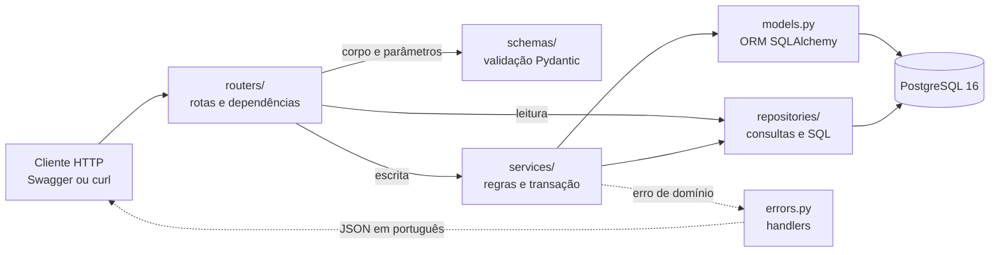
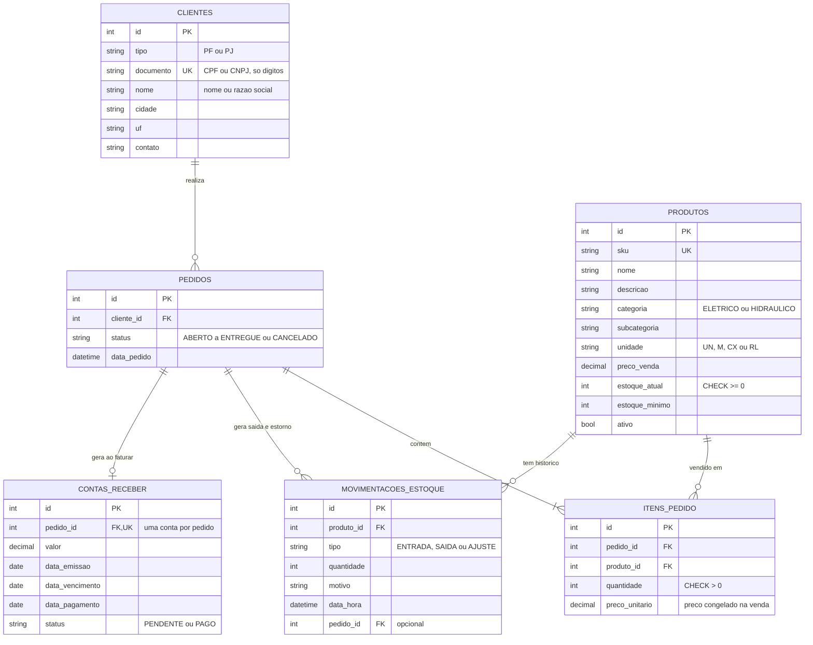
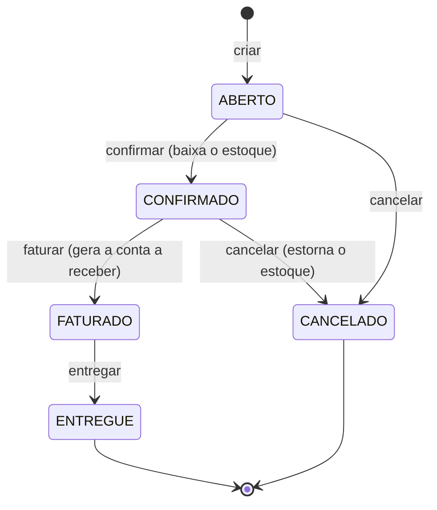
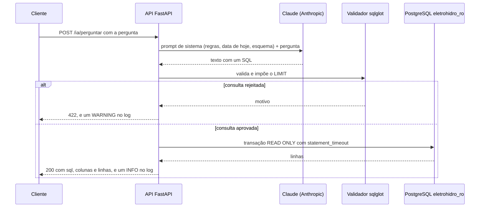

# EletroHidro Distribuidora — API

API REST de **estoque, vendas e financeiro** de uma distribuidora fictícia de materiais elétricos e hidráulicos,
feita em **Python 3.12 + FastAPI + PostgreSQL**. É um projeto de portfólio: CRUD com regras de negócio transacionais,
**relatórios em SQL escrito à mão** e uma **integração com IA (Claude)** que responde perguntas em português
consultando o banco, com travas de segurança.

- **29 operações HTTP**, documentadas no Swagger (`/docs`) com exemplos reais
- **5 relatórios em SQL puro**: joins, agregações, `RANK() OVER` e filtros opcionais
- **IA**: pergunta em português → SQL gerado pelo Claude → validado → executado só para leitura
- **192 testes** contra PostgreSQL real (98% de cobertura); `ruff` e `mypy` sem avisos

> Para ver funcionando: suba com `docker compose up` (passo a passo em [Como rodar](#como-rodar)) e abra
> `http://localhost:8000/docs`.

## Sumário

- **Visão geral:** [Problema de negócio](#problema-de-negócio) · [Funcionalidades](#funcionalidades) · [Stack](#stack)
- **Usando:** [Como rodar](#como-rodar) · [Configuração](#configuração) · [Exemplos de requisições](#exemplos-de-requisições) ·
  [Endpoints](#endpoints) · [Erros e mensagens](#erros-e-mensagens)
- **Por dentro:** [Arquitetura](#arquitetura) · [Estrutura do projeto](#estrutura-do-projeto) ·
  [Diagrama do banco](#diagrama-do-banco) · [Regras de negócio](#regras-de-negócio) · [Relatórios em SQL](#relatórios-em-sql) ·
  [IA e segurança](#ia-e-segurança) · [Dados de demonstração](#dados-de-demonstração) · [Testes](#testes)
- **Contexto:** [Decisões técnicas](#decisões-técnicas) · [Para quem vem do Spring](#para-quem-vem-do-spring) ·
  [Histórias de usuário](#histórias-de-usuário) · [Solução de problemas](#solução-de-problemas) ·
  [Limitações e próximos passos](#limitações-e-próximos-passos) · [Histórico do desenvolvimento](#histórico-do-desenvolvimento) ·
  [Glossário](#glossário)

## Problema de negócio

A EletroHidro revende fios, cabos, disjuntores, tomadas, tubos PVC, conexões e registros para construtoras,
instaladores e consumidores finais. Hoje o controle é feito em planilhas, e isso causa problemas conhecidos:

- **estoque que não bate**: vende-se o que não existe, ou não se sabe o que repor;
- **pedido sem rastro**: não há registro confiável do que saiu do estoque e por quê;
- **inadimplência invisível**: ninguém sabe, no dia, quais clientes estão com contas vencidas;
- **gestão sem números**: o faturamento por mês, o ranking de clientes e os produtos mais vendidos exigem horas de planilha.

A API centraliza o ciclo **produto → estoque → pedido → faturamento → recebimento** com regras que impedem
os erros acima (estoque nunca negativo, baixa de estoque atômica, uma conta por pedido) e responde as perguntas
de gestão direto do banco.

## Funcionalidades

| Área | O que faz |
|---|---|
| **Produtos** | CRUD com filtros (categoria, subcategoria, ativo, busca por nome/SKU) e paginação. Exclusão lógica (inativar). |
| **Clientes** | PF (CPF) e PJ (CNPJ) com validação dos dígitos verificadores, filtros por UF/tipo. |
| **Movimentações de estoque** | `ENTRADA`, `SAIDA` e `AJUSTE` sempre com data, quantidade e motivo. O estoque **nunca** fica negativo. |
| **Pedidos** | `ABERTO → CONFIRMADO → FATURADO → ENTREGUE` ou `CANCELADO`. Confirmar valida e baixa o estoque na mesma transação; cancelar um pedido confirmado estorna. |
| **Financeiro** | Faturar gera a conta a receber (valor, vencimento). Pagamento via endpoint. `VENCIDO` é calculado na leitura. |
| **Relatórios (SQL puro)** | Mais vendidos, faturamento por categoria e mês, ranking de clientes (com filtro por UF), estoque abaixo do mínimo e contas vencidas por cliente. |
| **IA** | `POST /ia/perguntar`: pergunta em português → SQL (Claude) → validação → execução **somente leitura** → resultado. |

## Stack

| Camada | Tecnologia | Para quê |
|---|---|---|
| Linguagem | **Python 3.12** | tipagem moderna (inclusive genéricos como `Pagina[T]`) |
| Web | **FastAPI** + **Uvicorn** | rotas, injeção de dependências e Swagger gerado do código |
| Validação | **Pydantic v2** | contratos de entrada e saída (os "DTOs") |
| Banco | **PostgreSQL 16** no **Docker Compose** | dados, `CHECK`s, locks e o usuário somente leitura da IA |
| Acesso a dados | **SQLAlchemy 2.x** (ORM) e **SQL à mão** via `text()` | ORM no CRUD; SQL puro nos relatórios |
| Migrações | **Alembic** | versionamento do esquema |
| IA | **SDK oficial da Anthropic** + **sqlglot** | gerar o SQL com o Claude e validá-lo com um parser |
| Testes | **pytest** + **httpx** (`TestClient`) | testes contra um PostgreSQL real |
| Qualidade | **ruff** + **mypy** | lint/formatação (PEP 8) e tipagem estática |

## Como rodar

### Com Docker Compose (recomendado)

Pré-requisito: Docker. Subir o banco e a API leva um comando:

```bash
cp .env.example .env          # PowerShell: Copy-Item .env.example .env
docker compose up --build
```

Em outro terminal, carregue os dados de demonstração (43 produtos, 10 clientes, 30 pedidos em vários meses):

```bash
docker compose exec api python -m app.seed
```

Pronto: **Swagger em http://localhost:8000/docs**. O `docker compose up` já aplica as migrações (`alembic upgrade head`)
e, na primeira criação do volume, cria o usuário PostgreSQL somente leitura usado pela IA.

- Troque as senhas de exemplo no `.env` se for expor a porta do banco (`5433` no seu computador).
- Para **habilitar a IA**, preencha `ANTHROPIC_API_KEY` no `.env` e reinicie. Sem a chave, só o `POST /ia/perguntar`
  responde `503`; todo o resto funciona normalmente. O modelo vem de `ANTHROPIC_MODEL` (padrão `claude-opus-5-5`;
  `claude-sonnet-5-5` ou `claude-haiku-5-5` são mais baratos).
- API e banco rodam no horário de Brasília (`FUSO_HORARIO=America/Sao_Paulo` no `.env`); troque se a operação for em outro fuso.
- Para recomeçar do zero: `docker compose exec api python -m app.seed --limpar`.
- Se você já tinha um volume de banco criado antes do usuário somente leitura existir, rode uma vez
  `docker compose exec db sh /docker-entrypoint-initdb.d/01-somente-leitura.sh` (o script é idempotente).
- Para parar: `docker compose down` (mantém os dados); `docker compose down -v` apaga também o banco.

### Rodando a API fora do Docker

Útil para desenvolver com recarga automática. O banco continua no Docker:

```bash
python -m venv .venv && source .venv/bin/activate     # Windows: .venv\Scripts\activate
pip install -r requirements-dev.txt
cp .env.example .env
docker compose up -d db                                # só o banco
alembic upgrade head
python -m app.seed
uvicorn app.main:app --reload
```

### Testes e qualidade

```bash
docker compose up -d db
pytest                          # suíte inteira
pytest tests/test_pedidos.py    # um arquivo
pytest -k estoque               # testes com "estoque" no nome
pytest --cov=app                # com cobertura
ruff check . && ruff format --check . && mypy app
```

Os testes usam um banco **separado** (`<nome do banco>_test`, criado automaticamente), então os dados de
desenvolvimento nunca são tocados. **Nenhum teste chama a API real da Anthropic**: o cliente é sempre simulado, e
a fixture do cliente real dispara erro se algum teste tentar usá-lo. Detalhes em [Testes](#testes).

## Configuração

Tudo vem de variáveis de ambiente, lidas do `.env` (modelo em `.env.example`). Nenhum segredo fica no código.

| Variável | Para quê | Padrão |
|---|---|---|
| `POSTGRES_USER`, `POSTGRES_PASSWORD`, `POSTGRES_DB` | usuário, senha e nome do banco criados pelo container | obrigatórias |
| `POSTGRES_PORT` | porta do banco no seu computador | `5433` |
| `READONLY_DB_PASSWORD` | senha do usuário somente leitura `eletrohidro_ro` (usado pela IA) | obrigatória |
| `FUSO_HORARIO` | fuso dos containers: define o "hoje" de vencimentos e filtros por dia | `America/Sao_Paulo` |
| `DATABASE_URL` | conexão da aplicação com o banco | obrigatória fora do Docker; no Compose é montada sozinha |
| `DATABASE_URL_READONLY` | conexão com o usuário somente leitura | sem ela a IA responde `503`; no Compose é montada sozinha |
| `ANTHROPIC_API_KEY` | chave da API do Claude | sem ela a IA responde `503` |
| `ANTHROPIC_MODEL` | modelo usado pela IA | `claude-opus-5-5` |
| `IA_MAX_LINHAS` | máximo de linhas devolvidas por pergunta | `100` (de 1 a 1000) |
| `IA_TIMEOUT_SEGUNDOS` | tempo máximo de uma consulta gerada pela IA | `5` (de 1 a 30) |

A leitura é feita por `app/config.py` (pydantic-settings): os tipos são convertidos e validados ao iniciar, então uma
configuração inválida derruba a aplicação na subida, não no meio de uma requisição.

## Exemplos de requisições

Os exemplos abaixo usam os dados do seed (o produto novo recebe o id 44). Nos terminais do Windows
(PowerShell e também Git Bash), prefira o Swagger ou `Invoke-RestMethod`: aspas e acentos se comportam de outro jeito
e um corpo com acentos mal codificado volta como `400`.

**1. Cadastrar um produto** (nasce com estoque 0) e **dar entrada** no estoque:

```bash
curl -X POST localhost:8000/produtos -H "Content-Type: application/json" -d '{
  "sku": "DJ-BIP-32A", "nome": "Disjuntor Bipolar 32A Curva C", "categoria": "ELETRICO",
  "subcategoria": "Disjuntores", "unidade": "UN", "preco_venda": "28.90", "estoque_minimo": 10 }'

curl -X POST localhost:8000/movimentacoes -H "Content-Type: application/json" -d '{
  "produto_id": 44, "tipo": "ENTRADA", "quantidade": 50, "motivo": "Compra do fornecedor - NF 1234" }'
```

**2. O estoque nunca fica negativo** (`409`, e nada é gravado):

```bash
curl -X POST localhost:8000/movimentacoes -H "Content-Type: application/json" -d '{
  "produto_id": 44, "tipo": "SAIDA", "quantidade": 80, "motivo": "Venda balcao" }'
# {"detail":"Estoque insuficiente para DJ-BIP-32A: saldo atual 50, movimentação de -80."}
```

**3. Validação com mensagem em português** (`422`):

```bash
curl -X POST localhost:8000/clientes -H "Content-Type: application/json" -d '{
  "tipo": "PF", "documento": "111.111.111-11", "nome": "Fulano", "cidade": "Santos", "uf": "SP" }'
# {"detail":"Dados inválidos.","erros":[{"campo":"documento","mensagem":"CPF inválido."}]}
```

**4. Ciclo do pedido**: criar → confirmar (baixa o estoque) → faturar (gera a conta) → pagar:

```bash
curl -X POST localhost:8000/pedidos -H "Content-Type: application/json" -d '{
  "cliente_id": 1, "itens": [ {"produto_id": 44, "quantidade": 10}, {"produto_id": 13, "quantidade": 20} ] }'
# {"id":31,"status":"ABERTO","itens":[{"produto_id":44,"quantidade":10,"preco_unitario":"28.90","subtotal":"289.00"}, ...],"total":"479.00", ...}

curl -X POST localhost:8000/pedidos/31/confirmar                       # status CONFIRMADO; estoque do produto 44: 50 → 40
curl -X POST "localhost:8000/pedidos/31/faturar?dias_vencimento=30"    # status FATURADO + conta a receber
curl "localhost:8000/contas-receber?pedido_id=31"                      # valor 479.00, vencimento daqui a 30 dias, PENDENTE
curl -X POST localhost:8000/contas-receber/23/pagamento                # PAGO (sem corpo = pago hoje)
```

**5. Confirmar é tudo ou nada**: um pedido com 1 unidade do produto 44 e 5 do produto 10 (estoque 0) falha, e a unidade do
produto 44 não é baixada:

```bash
curl -X POST localhost:8000/pedidos -H "Content-Type: application/json" -d '{
  "cliente_id": 2, "itens": [ {"produto_id": 44, "quantidade": 1}, {"produto_id": 10, "quantidade": 5} ] }'
# {"id":32,"status":"ABERTO", ...}

curl -X POST localhost:8000/pedidos/32/confirmar
# {"detail":"Estoque insuficiente para DJ-TRI-63A: saldo atual 0, movimentação de -5."}   (HTTP 409)
```

**6. Listagens com filtros e paginação**:

```bash
curl "localhost:8000/produtos?categoria=ELETRICO&subcategoria=Disjuntores&tamanho=5&pagina=1"
curl "localhost:8000/pedidos?status=CONFIRMADO&data_inicio=2026-10-01"
```

**7. Relatórios** (os de vendas aceitam `data_inicio`/`data_fim`; veja o Swagger para os demais filtros):

```bash
curl "localhost:8000/relatorios/produtos-mais-vendidos?limite=3"
# [{"sku":"CAB-PP-3X2.5","quantidade_vendida":99,"faturamento":"970.20", ...}, {"sku":"LAMP-LED-9W","quantidade_vendida":58, ...}, ...]

curl "localhost:8000/relatorios/faturamento-por-categoria-mes?data_inicio=2026-09-01"
# {"mes":"2026-09","categoria":"ELETRICO","faturamento":"1388.00","qtd_pedidos":3}, {"mes":"2026-09","categoria":"HIDRAULICO", ...}, ...

curl "localhost:8000/relatorios/ranking-clientes?uf=SP&limite=3"
# {"posicao":1,"nome":"Elétrica Brasil Instalações Ltda","qtd_pedidos":6,"faturamento":"3854.70", ...}, {"posicao":2, ...}

curl "localhost:8000/relatorios/estoque-abaixo-do-minimo?subcategoria=disjuntores"
# DJ-MONO-20A (13 de 40), DJ-MONO-32A (13 de 40), DJ-TRI-63A (0 de 10)

curl localhost:8000/relatorios/contas-vencidas        # total vencido, quantidade e dias de atraso por cliente
```

**8. Pergunta em português (IA)**. Requer `ANTHROPIC_API_KEY`:

```bash
curl -X POST localhost:8000/ia/perguntar -H "Content-Type: application/json" \
  -d '{"pergunta": "Quais disjuntores estão abaixo do estoque mínimo?"}'
```

Formato da resposta. O SQL é o tipo de consulta que o modelo costuma gerar para essa pergunta; o resultado é o que o
pipeline devolve sobre os dados do seed, com validação e usuário somente leitura reais:

```json
{
  "pergunta": "Quais disjuntores estão abaixo do estoque mínimo?",
  "sql": "SELECT sku, nome, estoque_atual, estoque_minimo FROM produtos WHERE ativo AND subcategoria ILIKE 'Disjuntores' AND estoque_atual < estoque_minimo ORDER BY sku LIMIT 101",
  "colunas": ["sku", "nome", "estoque_atual", "estoque_minimo"],
  "linhas": [
    ["DJ-MONO-20A", "Disjuntor Monopolar 20A Curva C", 13, 40],
    ["DJ-MONO-32A", "Disjuntor Monopolar 32A Curva C", 13, 40],
    ["DJ-TRI-63A", "Disjuntor Tripolar 63A Curva C", 0, 10]
  ],
  "total_linhas": 3,
  "truncado": false
}
```

Sem a chave configurada: `503` com `"O recurso de IA está desativado: defina a variável de ambiente ANTHROPIC_API_KEY. O restante da API funciona normalmente."`

## Endpoints

| Recurso | Rotas |
|---|---|
| Produtos | `POST /produtos` · `GET /produtos` · `GET/PATCH/DELETE /produtos/{id}` (DELETE = inativar) |
| Clientes | `POST /clientes` · `GET /clientes` · `GET/PATCH/DELETE /clientes/{id}` |
| Movimentações | `POST /movimentacoes` · `GET /movimentacoes` |
| Pedidos | `POST /pedidos` · `GET /pedidos` · `GET /pedidos/{id}` · `POST /pedidos/{id}/confirmar` · `/faturar` · `/entregar` · `/cancelar` |
| Financeiro | `GET /contas-receber` · `GET /contas-receber/{id}` · `POST /contas-receber/{id}/pagamento` |
| Relatórios | `GET /relatorios/produtos-mais-vendidos` · `/faturamento-por-categoria-mes` · `/ranking-clientes` · `/estoque-abaixo-do-minimo` · `/contas-vencidas` |
| IA | `POST /ia/perguntar` |
| Infra | `GET /saude` |

Todas as listagens aceitam `pagina` (a partir de 1) e `tamanho` (até 100) e devolvem `{"itens": [...], "total", "pagina", "tamanho"}`.
Os filtros de cada uma estão descritos no Swagger.

## Erros e mensagens

Toda resposta de erro é JSON e está em português. Há dois formatos:

```json
{"detail": "Produto não encontrado."}
```

```json
{"detail": "Dados inválidos.", "erros": [{"campo": "preco_venda", "mensagem": "deve ser maior ou igual a 0"}]}
```

O segundo é o das validações (`422`): uma entrada por campo com problema. Erros que envolvem o corpo inteiro (por
exemplo, enviar uma lista em vez de um objeto) aparecem com `"campo": "corpo"`.

| Código | Quando acontece | Exemplo de `detail` |
|---|---|---|
| `400` | parâmetro inválido | `data_inicio não pode ser posterior a data_fim.` |
| `404` | registro ou rota inexistente | `Produto não encontrado.` |
| `409` | conflito com o estado atual | `Estoque insuficiente para DJ-BIP-32A: saldo atual 50, movimentação de -80.` |
| `422` | dados inválidos ou fora dos limites | `Dados inválidos.` (com `erros`) · `Valor fora do intervalo suportado.` |
| `500` | falha inesperada (o detalhe técnico fica no log) | `Erro interno do servidor.` |
| `502` | falha ao falar com a Anthropic (só na IA) | `Limite de uso da API da Anthropic atingido; tente novamente em instantes.` |
| `503` | IA não configurada | `O recurso de IA está desativado: defina a variável de ambiente ANTHROPIC_API_KEY. ...` |

As mensagens padrão do Pydantic e do FastAPI vêm em inglês; `app/errors.py` traduz todas as que a API pode produzir,
e um tipo de erro desconhecido vira "valor inválido", nunca um texto em inglês. O Swagger documenta esses dois
formatos reais (o padrão do FastAPI descreveria outro formato para o `422`).

## Arquitetura

O código é dividido em camadas, cada uma com uma responsabilidade:



| Camada | Pasta | Responsabilidade |
|---|---|---|
| Rotas | `app/routers/` | traduz HTTP: recebe a requisição, injeta dependências (`Depends`), chama o service ou o repositório e devolve o `response_model`. Não tem regra de negócio. |
| Contratos | `app/schemas/` | modelos Pydantic de entrada e saída. A validação acontece antes de a rota rodar; um campo inválido nunca chega ao service. |
| Regras | `app/services/` | regras de negócio e fronteira da transação (`with transacao(db)`). Lança exceções de domínio (`Conflito`, `NaoEncontrado`...) sem saber nada de HTTP. |
| Consultas | `app/repositories/` | listagens com filtros e paginação (ORM), os relatórios em SQL puro e a execução somente leitura da IA. |
| Modelo | `app/models.py` | tabelas, `CHECK`s, chaves e valores calculados (`Pedido.total`, `ContaReceber.situacao`). |
| Erros | `app/errors.py` | converte exceções em respostas HTTP padronizadas. |

**O caminho de uma requisição**, usando `POST /pedidos/31/confirmar` como exemplo:

1. O Uvicorn recebe a requisição e o FastAPI encontra a rota em `routers/pedidos.py`.
2. As dependências rodam: `get_db` abre uma sessão de banco só para esta requisição; o `31` é validado como inteiro.
3. A rota chama `services.pedidos.confirmar(db, 31)`.
4. O service abre a transação (`with transacao(db)`) e trava o pedido com `SELECT ... FOR UPDATE`, para que duas
   confirmações simultâneas não passem juntas. Confere se o status é `ABERTO`.
5. Para cada item, em ordem de `produto_id`, `services/estoque.py` trava o produto, confere o saldo, baixa o estoque e grava
   a movimentação `SAIDA` ligada ao pedido.
6. Se tudo deu certo, o status vira `CONFIRMADO` e a transação é confirmada (commit). A resposta é o pedido, convertido
   pelo `PedidoResposta` (dinheiro sai como string, por exemplo `"479.00"`).
7. Se faltar estoque em qualquer item, o service lança `Conflito`, a transação é desfeita (rollback, o que também libera
   os locks), nenhum item fica baixado e o handler devolve `409` com a mensagem em português.

## Estrutura do projeto

```
app/
  main.py                # cria o FastAPI, registra routers e handlers, ajusta o Swagger
  config.py              # variáveis de ambiente (pydantic-settings)
  database.py            # engine, sessão por requisição e o helper transacao()
  models.py              # modelos SQLAlchemy das 6 tabelas, enums e CHECKs
  errors.py              # exceções de domínio, handlers HTTP e formato dos erros
  paginacao.py           # ?pagina=&tamanho= e a resposta paginada Pagina[T]
  periodo.py             # ?data_inicio=&data_fim= e os limites do dia no fuso da aplicação
  validadores.py         # dígitos verificadores de CPF e CNPJ
  seed.py                # dados de demonstração (python -m app.seed)
  routers/               # uma rota por recurso: produtos, clientes, movimentacoes, pedidos,
                         #   contas_receber, relatorios, ia
  schemas/               # contratos Pydantic de cada recurso; tipos.py tem os inteiros com limite
  services/              # produtos, clientes, estoque, pedidos, contas_receber, ia, sql_seguro
  repositories/          # listagens (ORM), relatorios.py (SQL puro), leitura.py (execução da IA)
alembic/                 # env.py e as migrações (versions/)
docker/initdb/           # 01-somente-leitura.sh: cria o usuário PostgreSQL somente leitura
tests/                   # pytest: banco real e Anthropic simulada (ver Testes)
docker-compose.yml       # serviços db (PostgreSQL 16) e api
Dockerfile               # imagem da API (usuário não-root)
pyproject.toml           # configuração do ruff e do mypy
requirements*.txt        # dependências de produção e de desenvolvimento
.env.example             # modelo das variáveis de ambiente
```

## Diagrama do banco



O total do pedido não é uma coluna: é calculado dos itens, então nunca fica dessincronizado. A situação `VENCIDO`
também é derivada (conta `PENDENTE` com vencimento no passado) em vez de gravada.

O esquema é criado pela migração do Alembic em `alembic/versions/`, gerada a partir de `app/models.py` e revisada.
As constraints têm nomes fixos (convenção em `database.py`), o que permite alterá-las em migrações futuras.

## Regras de negócio

### Estoque

- O saldo (`estoque_atual`) **só muda por movimentação**: a API recusa esse campo no cadastro e na edição do produto,
  então todo saldo tem histórico.
- `ENTRADA` soma, `SAIDA` subtrai e `AJUSTE` soma com sinal (positivo para sobra, negativo para perda no inventário).
  Quantidade zero é recusada, e `ENTRADA`/`SAIDA` com quantidade negativa também.
- Toda movimentação guarda data e hora (do servidor), quantidade, motivo (de 3 a 200 caracteres) e, quando veio de um
  pedido, o pedido de origem.
- **O saldo nunca fica negativo.** O service recusa a movimentação com `409`; se um bug deixasse passar, o
  `CHECK (estoque_atual >= 0)` do banco recusaria.
- Durante a movimentação a linha do produto fica travada (`SELECT ... FOR UPDATE`), e duas saídas simultâneas não
  conseguem vender o mesmo saldo.

### Ciclo do pedido



| Ação | Status | O que acontece (na mesma transação) | Quando é recusada |
|---|---|---|---|
| criar `POST /pedidos` | → `ABERTO` | copia o preço atual de cada produto para o item; o estoque não muda | cliente ou produto inexistente (`404`), produto inativo (`409`), itens vazios ou repetidos, total acima do suportado (`422`) |
| `confirmar` | `ABERTO` → `CONFIRMADO` | uma `SAIDA` por item, com os produtos travados em ordem de id | status diferente de `ABERTO` ou estoque insuficiente em qualquer item (`409`); nesse caso nada é baixado |
| `faturar?dias_vencimento=30` | `CONFIRMADO` → `FATURADO` | cria a conta a receber: valor = total, emissão = hoje, vencimento = hoje + prazo | status diferente de `CONFIRMADO` ou total zero (`409`) |
| `entregar` | `FATURADO` → `ENTREGUE` | só a mudança de status | status diferente de `FATURADO` (`409`) |
| `cancelar` | `ABERTO`/`CONFIRMADO` → `CANCELADO` | se estava `CONFIRMADO`, uma `ENTRADA` de estorno por item | pedido faturado, entregue ou já cancelado (`409`) |

### Financeiro

- Cada pedido gera **no máximo uma** conta a receber (`UNIQUE (pedido_id)` no banco).
- O banco grava `PENDENTE` ou `PAGO`. `VENCIDO` é calculado: conta `PENDENTE` com vencimento anterior a hoje. A mesma
  regra vale na resposta da API, no filtro `GET /contas-receber?status=VENCIDO`, no relatório de vencidas e no prompt
  da IA.
- O pagamento é integral: `POST /contas-receber/{id}/pagamento`, com data opcional (o padrão é hoje). A data não pode ser
  futura nem anterior à emissão (`400`), e pagar duas vezes dá `409`.

### Onde cada regra é garantida

| Regra | Garantida por | Teste que prova |
|---|---|---|
| Estoque nunca negativo | `services/estoque.py` (409) e `CHECK` no banco | `test_saida_maior_que_o_saldo_retorna_409_e_nao_altera_nada`, `test_ajuste_negativo_reduz_e_nao_pode_negativar` |
| Saldo só muda por movimentação | `extra="forbid"` nos schemas de produto | `test_nao_aceita_estoque_atual_na_criacao`, `test_estoque_nao_pode_ser_alterado_via_patch` |
| Saldo = soma do histórico | movimentação gravada junto com cada mudança de saldo | `test_estoque_confere_com_a_soma_das_movimentacoes` |
| Saídas simultâneas não vendem o mesmo saldo | `SELECT ... FOR UPDATE` no produto | `test_saidas_concorrentes_nao_vendem_o_mesmo_estoque` |
| Preço congelado na venda | `ItemPedido.preco_unitario` copiado na criação | `test_criar_pedido_congela_preco_e_calcula_total` |
| Confirmar é tudo ou nada | `with transacao(db)` em `services/pedidos.py` | `test_confirmar_sem_estoque_em_um_item_nao_altera_nada` |
| Cancelar confirmado estorna | `services/pedidos.cancelar` | `test_cancelar_pedido_confirmado_estorna_o_estoque` |
| Pedido faturado não é cancelado | checagem de status | `test_nao_cancela_pedido_cancelado_nem_faturado` |
| Uma conta por pedido | `UNIQUE` no banco, status e lock no pedido | `test_faturar_duas_vezes_gera_uma_unica_conta` |
| Total que não cabe na conta é recusado na criação | `services/pedidos.criar` | `test_pedido_com_total_acima_do_suportado_e_recusado_ja_na_criacao` |
| `VENCIDO` derivado | `ContaReceber.situacao` e filtro no repositório | `test_conta_pendente_com_vencimento_passado_aparece_como_vencida` |
| Pagamento único e com data válida | lock na conta e checagens de data | `test_pagar_conta_ja_paga_retorna_409`, `test_data_de_pagamento_invalida_retorna_400` |
| CPF/CNPJ válidos e únicos | `validadores.py`, `UNIQUE` e `CHECK` no banco | `test_cpf_invalido_retorna_422`, `test_cnpj_invalido_em_cliente_pj`, `test_documento_duplicado_retorna_409` |
| Inteiro não aceita `true` nem `"5"` | tipos estritos em `schemas/tipos.py` | `test_quantidade_booleana_nao_vira_1_unidade` |
| Filtro por dia no fuso de Brasília | `periodo.py` | `test_pedido_feito_a_noite_aparece_no_filtro_do_proprio_dia` |

Dois pedidos com os mesmos produtos em ordem oposta não travam um ao outro (*deadlock*) porque os produtos são sempre
travados em ordem crescente de id. Isso foi verificado com 30 confirmações simultâneas por HTTP, fora da suíte de testes.

## Relatórios em SQL

Os cinco relatórios estão em `app/repositories/relatorios.py`, escritos à mão e executados com `text()`. Convenções:

- **Venda efetivada** é um pedido `FATURADO` ou `ENTREGUE`. Pedidos abertos, confirmados e cancelados não entram no
  faturamento.
- O **período** filtra pela data de faturamento (`contas_receber.data_emissao`), não pela criação do pedido.
- Todo valor entra como **parâmetro bind** (`:nome`), nunca concatenado no texto: é o que impede SQL injection,
  como o `PreparedStatement` do JDBC.
- Filtro opcional no próprio SQL: `CAST(:uf AS varchar) IS NULL OR cl.uf = :uf`. Parâmetro nulo significa "sem filtro".
  O `CAST` é necessário porque o PostgreSQL não deduz o tipo de um parâmetro nulo usado só em `IS NULL`.

| Rota | Responde | Técnicas de SQL | Filtros |
|---|---|---|---|
| `/produtos-mais-vendidos` | quantidade e faturamento por produto | `JOIN` de 4 tabelas, `SUM`, `GROUP BY`, `ORDER BY`, `LIMIT` | período, categoria, limite |
| `/faturamento-por-categoria-mes` | faturamento e nº de pedidos por mês e categoria | `to_char(data, 'YYYY-MM')`, `SUM`, `COUNT(DISTINCT)` | período |
| `/ranking-clientes` | posição, nº de pedidos e faturamento por cliente | função de janela `RANK() OVER`, `JOIN`, `GROUP BY` | período, UF, limite |
| `/estoque-abaixo-do-minimo` | produtos ativos com saldo menor que o mínimo e quanto falta | coluna calculada, `ILIKE`, ordenação pela falta | categoria, subcategoria, limite |
| `/contas-vencidas` | total vencido, nº de contas, vencimento mais antigo e dias de atraso por cliente | `JOIN`, `SUM`, `MIN`, aritmética de datas | data de referência, limite |

Exemplo, o ranking de clientes (trecho de `relatorios.py`):

```sql
SELECT RANK() OVER (ORDER BY SUM(c.valor) DESC) AS posicao,
       cl.id AS cliente_id, cl.nome, cl.cidade, cl.uf,
       COUNT(*)     AS qtd_pedidos,
       SUM(c.valor) AS faturamento
  FROM pedidos ped
  JOIN clientes cl       ON cl.id = ped.cliente_id
  JOIN contas_receber c  ON c.pedido_id = ped.id
 WHERE ped.status IN ('FATURADO', 'ENTREGUE')
   AND (CAST(:data_inicio AS date) IS NULL OR c.data_emissao >= :data_inicio)
   AND (CAST(:data_fim    AS date) IS NULL OR c.data_emissao <= :data_fim)
   AND (CAST(:uf AS varchar) IS NULL OR cl.uf = :uf)
 GROUP BY cl.id, cl.nome, cl.cidade, cl.uf
 ORDER BY faturamento DESC, cl.id
 LIMIT :limite
```

O `RANK()` é calculado sobre as linhas já agrupadas e antes do `LIMIT`: empates dividem a mesma posição, e pedir
`limite=1` ainda mostra a posição real. Com `uf=MG`, o primeiro de Minas aparece na posição 1, porque o `WHERE` roda
antes da janela.

## IA e segurança

`POST /ia/perguntar` recebe uma pergunta em português, pede ao Claude uma consulta SQL, valida essa consulta e a executa
com um usuário de banco que só pode ler.



**O que o modelo recebe** (`app/services/ia.py`):
- **Prompt de sistema**: as regras de saída (responder só com o SQL, um único `SELECT`, ou `NAO_POSSIVEL: motivo` se a
  pergunta não puder ser respondida com os dados), as regras de negócio (o que é venda efetivada, conta vencida,
  estoque abaixo do mínimo), a data de hoje e o esquema das 6 tabelas, gerado a partir dos modelos ORM.
- **Mensagem do usuário**: só a pergunta. O prompt manda ignorar instruções dentro dela.

A resposta traz o `sql` realmente executado (já com o `LIMIT`), as `colunas`, as `linhas` (uma lista por linha, na
ordem das colunas, para que duas colunas `nome` num `JOIN` não colidam), o `total_linhas` e `truncado`, que indica se
havia mais linhas que o máximo.

O modelo gera texto, e **texto gerado por modelo é entrada não confiável** (pode errar, ou ser manipulado por uma pergunta
maliciosa, o chamado *prompt injection*). Por isso a segurança não depende de o modelo "se comportar": há camadas
independentes, e as do banco continuam valendo mesmo que as da aplicação falhem.

| # | Camada | Onde | O que garante |
|---|---|---|---|
| 1 | **Esquema mínimo** | prompt | O modelo só vê as 6 tabelas do domínio (geradas dos modelos ORM). `alembic_version` e tabelas do sistema nunca são reveladas. |
| 2 | **Parser SQL** (`sqlglot`) | aplicação | Exatamente **um** `SELECT`. Recusa `INSERT/UPDATE/DELETE/DDL/COPY/SET`, inclusive escondidos em CTE, e `SELECT INTO`/`FOR UPDATE`. Falha fechada: o que o parser não entende é recusado. Executa o SQL **regenerado** da árvore validada, não o texto original. |
| 3 | **Allowlist** | aplicação | Só as tabelas do domínio. Schemas `pg_catalog`/`information_schema` e funções perigosas (`pg_*`, `lo_*`, `dblink`, `set_config`, `nextval`/`setval`, `version`) são bloqueados. |
| 4 | **LIMIT máximo** | aplicação | `LIMIT` imposto (`IA_MAX_LINHAS`, padrão 100); a resposta indica `truncado`. |
| 5 | **Usuário somente leitura** | banco | `eletrohidro_ro` só tem `GRANT SELECT`. Mesmo um `DELETE` que passasse pelo parser levaria `permission denied`. |
| 6 | **Transação `READ ONLY` + timeout** | banco | O papel força `default_transaction_read_only` e `statement_timeout`; a execução abre a transação como `READ ONLY` e cancela a consulta após `IA_TIMEOUT_SEGUNDOS` (padrão 5). |
| 7 | **Trilha de auditoria** | aplicação | Toda consulta executada é registrada no log (`app.services.ia`) com a pergunta e o SQL; as **rejeitadas** também, em nível `WARNING`, com o SQL recusado e o motivo. |

Cada camada tem teste próprio: o de camada 5 contorna o parser de propósito, e o `SELECT pg_sleep()` contorna o validador
para provar o timeout. Numa verificação feita à parte, fora da suíte, o validador também recebeu 4.020 variações de
comandos perigosos (maiúsculas e minúsculas misturadas, comentários entre palavras, espaços Unicode, nomes entre aspas), e
nenhuma passou.

**Respostas de erro da IA**: `422` quando a consulta é rejeitada, o modelo recusa, a consulta falha ou estoura o tempo;
`502` quando a API da Anthropic falha (chave recusada, limite de uso, modelo inexistente, sem conexão); `503` quando falta
`ANTHROPIC_API_KEY` ou `DATABASE_URL_READONLY`.

**Custo**: cada pergunta faz uma chamada ao modelo, cobrada por tokens de entrada e saída. O preço depende do modelo
escolhido em `ANTHROPIC_MODEL`; os modelos Sonnet e Haiku custam menos que o Opus.

## Dados de demonstração

`python -m app.seed` cria dados realistas e **determinísticos** (semente fixa: rodar de novo gera exatamente os mesmos dados):

- **43 produtos**: 22 elétricos e 20 hidráulicos ativos, em 16 subcategorias (fios e cabos, disjuntores, tomadas,
  interruptores, iluminação, tubos PVC, conexões, registros, torneiras, vedação etc.), mais 1 descontinuado e inativo.
- **10 clientes**: 8 empresas (CNPJ) e 2 pessoas físicas (CPF) de SP, MG, RJ, PR e SC, todos com documento válido.
- **30 pedidos** espalhados pelos últimos 7 meses: 14 entregues, 8 faturados, 4 confirmados, 2 abertos e 2 cancelados
  (um deles cancelado depois de confirmado, com estorno).
- **22 contas a receber**: 10 pagas e 12 vencidas.
- **7 produtos abaixo do estoque mínimo** (3 deles disjuntores), para o relatório de reposição.

O seed não grava pedidos "na marra": passa pelos mesmos services da API (criar, confirmar, faturar, entregar, cancelar,
pagar). Por isso os dados nascem consistentes, e o seed funciona também como um teste de ponta a ponta das regras.
Depois, as datas são recuadas para espalhar os pedidos pelos meses. Ele se recusa a rodar num banco que já tem dados;
`--limpar` apaga tudo antes.

## Testes

**Estratégia:**
- **Banco real.** As regras dependem do PostgreSQL (`CHECK`, `FOR UPDATE`, o SQL dos relatórios), então os testes usam
  um PostgreSQL de verdade, num banco separado criado automaticamente (`<nome do banco>_test`). Cada teste começa com as
  tabelas vazias.
- **Pelo caminho real.** A maioria dos testes chama a API com o `TestClient` (HTTP em memória), passando por rotas,
  validação, services e banco.
- **Anthropic sempre simulada.** O cliente do Claude é trocado por um `MagicMock` (`app.dependency_overrides`). Se algum
  teste tentasse usar o cliente real, ele dispararia um erro. Um teste usa o SDK real sobre um transporte HTTP falso, para
  conferir o formato exato da chamada.
- **Valores calculados à mão.** Os relatórios são testados contra um conjunto pequeno de dados cujos resultados esperados
  estão escritos no próprio arquivo de teste.

| Arquivo | Testes | O que cobre |
|---|---:|---|
| `test_produtos.py` | 10 | CRUD, SKU duplicado, `422` em português, filtros, paginação, estoque não editável |
| `test_clientes.py` | 10 | PF/PJ, CPF/CNPJ inválidos, UF, duplicidade, exclusão com e sem pedidos |
| `test_movimentacoes.py` | 9 | entrada, saída e ajuste, saldo nunca negativo, saídas concorrentes (*lost update*) |
| `test_pedidos.py` | 14 | criação com preço congelado, confirmação atômica, cancelamento com estorno, faturamento, entrega, transições inválidas, filtros |
| `test_financeiro.py` | 6 | pagamento, pagamento duplicado, datas inválidas, `VENCIDO` derivado, filtro por cliente |
| `test_relatorios.py` | 10 | os 5 relatórios contra valores calculados à mão, filtros e resultados vazios |
| `test_ia.py` | 77 | validador de SQL (dezenas de consultas aceitas e rejeitadas), travas do próprio banco, endpoint com modelo simulado, falhas da Anthropic |
| `test_limites.py` | 27 | valores extremos, mensagens sempre em português, fuso nos filtros, Swagger fiel aos erros reais |
| `test_bordas.py` | 10 | filtros e casos de borda, log de auditoria da IA, erros do framework em português |
| `test_seed.py` | 7 | seed consistente (saldo = soma das movimentações) e determinístico |
| `test_validadores.py` | 11 | dígitos verificadores de CPF e CNPJ |
| `test_saude.py` | 1 | rota de saúde |
| **Total** | **192** | cobertura de 98% do código da aplicação |

## Decisões técnicas

- **Camadas** (`routers` → `services` → `repositories`, mais `schemas` Pydantic). O service decide a transação; o router só traduz HTTP.
  Relatórios não têm service: são consultas puras de leitura.
- **ORM para escrita, SQL para análise.** O CRUD usa SQLAlchemy; os 5 relatórios são SQL à mão, com parâmetros *bind*
  (sem concatenar texto), `JOIN`, `GROUP BY`, `COUNT(DISTINCT)`, filtros opcionais e `RANK() OVER`.
- **Regras no banco, não só no código.** `CHECK (estoque_atual >= 0)`, `UNIQUE (pedido_id)` em contas, `CHECK` de CPF/CNPJ por tipo.
  Um bug na aplicação não consegue corromper os dados.
- **Transações explícitas e locks.** Cada transição de pedido é uma transação (`with transacao(db)`); linhas são travadas com
  `SELECT ... FOR UPDATE`. Os produtos são travados **em ordem de id** para dois pedidos nunca causarem *deadlock*. Há teste
  que reproduz o *lost update* (vender 12 de um estoque de 10) e falha sem o lock.
- **O estoque só muda por movimentação.** `estoque_atual` não é editável pela API; todo saldo tem trilha de auditoria
  (o teste do seed confere que saldo = soma das movimentações para todos os produtos).
- **Preço congelado no item**, **total calculado** e **`VENCIDO` derivado**: dados derivados não ficam gravados para não envelhecer.
- **Dinheiro é `Decimal`** (`NUMERIC(12,2)`), serializado como string no JSON; nunca `float`.
- **Erros centralizados** em um único *handler*: services lançam exceções de domínio sem saber de HTTP; o `422` do Pydantic é
  traduzido para português, com campo e mensagem (um tipo de erro não mapeado vira "valor inválido", nunca texto em inglês).
  O Swagger documenta esse formato real de erro, não o padrão do FastAPI.
- **Validação na fronteira com limites explícitos.** Inteiros do corpo são estritos (`true` ou `"5"` não viram número em
  silêncio) e têm teto (quantidade até 1.000.000; ids até o maior `INTEGER`). Um pedido cujo total não caberia na conta a
  receber é recusado já na criação. Como rede de segurança, qualquer valor que o banco recuse por estar fora do intervalo
  vira `422` em vez de `500`.
- **Datas no horário de Brasília.** No Docker, os containers da API e do banco rodam no fuso `FUSO_HORARIO`
  (padrão `America/Sao_Paulo`): é ele que define o "hoje" dos vencimentos e dos filtros por dia. Além disso, os filtros por
  dia em colunas `timestamptz` são convertidos explicitamente para o fuso da aplicação; comparar direto com uma data usaria o
  fuso da sessão do banco, e um pedido feito às 22h poderia cair no dia seguinte. A IA recebe a data de hoje no prompt,
  pelo mesmo motivo.
- **Testes contra PostgreSQL real**, em banco separado, porque as regras dependem de recursos do Postgres (`CHECK`, `FOR UPDATE`,
  SQL dos relatórios). SQLite esconderia bugs reais. Os valores esperados dos relatórios foram calculados à mão.
- **Migrações com Alembic**, geradas por *autogenerate* e revisadas; convenção de nomes para as constraints.
- **Seed pelos próprios services**, não por `INSERT`: os dados nascem consistentes e o seed funciona como teste de ponta a ponta.
  É determinístico (semente fixa) e recua as datas para os relatórios por mês fazerem sentido.
- **Container mais seguro.** A API roda com um usuário sem privilégios de root, e o Compose só considera a API pronta
  depois de ela responder ao healthcheck (`docker compose up --wait` espera de verdade).

## Para quem vem do Spring

O projeto foi escrito por alguém vindo de Java/Spring Boot. Esta tabela mostra onde cada conceito conhecido aparece aqui.

| Conceito | Spring Boot | Neste projeto |
|---|---|---|
| Controller | `@RestController` + `@GetMapping` | `APIRouter` + `@router.get` (`app/routers/`) |
| DTO e validação | classes + Bean Validation (`@Valid`, `@NotNull`) | modelos Pydantic (`app/schemas/`), validados automaticamente antes da rota |
| Entidade | `@Entity` (JPA/Hibernate) | modelo SQLAlchemy 2 com `Mapped[...]` (`app/models.py`) |
| Repositório | `JpaRepository` | funções com `select()` em `app/repositories/` |
| SQL nativo | `JdbcTemplate` ou `@Query(nativeQuery = true)` | `text()` com parâmetros *bind* (`repositories/relatorios.py`) |
| Transação | `@Transactional` (implícito, por proxy) | `with transacao(db):` (explícito, em `database.py`) |
| Lock pessimista | `@Lock(LockModeType.PESSIMISTIC_WRITE)` | `db.get(Modelo, id, with_for_update=True)` |
| Evitar N+1 | `JOIN FETCH` ou `@EntityGraph` | `selectinload(Pedido.itens)` |
| Injeção de dependência | beans, `@Autowired` ou construtor | `Depends(...)` na assinatura da rota |
| Tratamento global de erros | `@ControllerAdvice` + `@ExceptionHandler` | `registrar_handlers()` (`app/errors.py`) |
| Configuração | `application.properties` + `@ConfigurationProperties` | pydantic-settings lendo o `.env` (`app/config.py`) |
| Migrações | Flyway ou Liquibase | Alembic (`alembic/`); o *autogenerate* compara os modelos com o banco |
| Paginação | `Pageable` e `Page<T>` | dependência `paginacao()` e `Pagina[T]` (`app/paginacao.py`) |
| Mock em teste | `@MockBean` | `app.dependency_overrides[...]` |
| Teste de integração | `@SpringBootTest` + MockMvc | `TestClient` do FastAPI |
| Documentação da API | springdoc-openapi | Swagger gerado pelo próprio FastAPI (`/docs`) |
| Servidor | Tomcat embutido | Uvicorn (servidor ASGI) |
| Dependências | Maven ou Gradle | `requirements.txt` + ambiente virtual (`.venv`) |

A diferença que mais aparece no código é a transação: no Spring o `@Transactional` abre e fecha a transação de forma
implícita; aqui o `with transacao(db)` deixa visível exatamente onde a transação começa, onde é confirmada e onde é
desfeita.

## Histórias de usuário

### 1. Controlar o estoque
**Como** almoxarife, **quero** registrar entradas, saídas e ajustes, **para** que o saldo reflita o que está na prateleira.

- **Dado** um produto com saldo 50, **quando** registro uma SAÍDA de 20, **então** o saldo passa a 30 e fica registrada uma movimentação com data, quantidade e motivo.
- **Dado** um produto com saldo 5, **quando** registro uma SAÍDA de 6, **então** a API responde `409` ("Estoque insuficiente"), o saldo continua 5 e nenhuma movimentação é gravada.
- **Dado** um produto com saldo 10, **quando** registro um AJUSTE de −3 (perda no inventário), **então** o saldo passa a 7; **e** um AJUSTE que o deixaria negativo é recusado com `409`.
- **Dado** uma movimentação sem motivo, ou ENTRADA com quantidade negativa, **quando** envio, **então** recebo `422` indicando o campo e a mensagem em português.

### 2. Montar, confirmar e cancelar pedidos
**Como** vendedor, **quero** criar pedidos e confirmá-los, **para** reservar o estoque sem vender o que não existe.

- **Dado** um cliente e produtos ativos, **quando** crio um pedido, **então** ele nasce `ABERTO`, com o preço atual de cada produto congelado nos itens, e o estoque permanece intacto.
- **Dado** um pedido `ABERTO` com estoque suficiente, **quando** o confirmo, **então** o status vira `CONFIRMADO` e uma SAÍDA por item é registrada na mesma transação.
- **Dado** um pedido de dois itens em que um não tem estoque, **quando** o confirmo, **então** recebo `409`, **nenhum** item é baixado e o pedido continua `ABERTO`.
- **Dado** um pedido `CONFIRMADO`, **quando** o cancelo, **então** ele vira `CANCELADO` e o estoque é estornado por ENTRADAs; **e** um pedido já faturado não pode ser cancelado (`409`).

### 3. Faturar e acompanhar recebimentos
**Como** analista financeiro, **quero** faturar pedidos e registrar pagamentos, **para** saber quanto há a receber e de quem.

- **Dado** um pedido `CONFIRMADO`, **quando** o fatura com `dias_vencimento=30`, **então** ele vira `FATURADO` e é criada uma conta `PENDENTE` com o valor do pedido e vencimento em 30 dias.
- **Dado** um pedido ainda não confirmado, **quando** tento faturá-lo, **então** recebo `409` e nenhuma conta é criada; **e** faturar duas vezes nunca gera duas contas.
- **Dado** uma conta `PENDENTE`, **quando** registro o pagamento, **então** ela vira `PAGO` com a data; um segundo pagamento retorna `409` e uma data futura retorna `400`.
- **Dado** uma conta `PENDENTE` com vencimento no passado, **quando** a consulto, **então** ela aparece como `VENCIDO` e entra em `GET /contas-receber?status=VENCIDO`.

### 4. Analisar vendas e reposição
**Como** gerente, **quero** relatórios de faturamento, clientes e estoque, **para** decidir compras e cobranças.

- **Dado** pedidos faturados em meses diferentes, **quando** consulto `/relatorios/faturamento-por-categoria-mes`, **então** recebo uma linha por mês e categoria; pedidos abertos, confirmados e cancelados **não** entram.
- **Dado** clientes de várias UFs, **quando** consulto `/relatorios/ranking-clientes?uf=SP`, **então** vejo só clientes de SP, do maior para o menor faturamento, com a posição de cada um.
- **Dado** produtos com saldo menor que o mínimo, **quando** consulto `/relatorios/estoque-abaixo-do-minimo?subcategoria=disjuntores`, **então** recebo os produtos ativos nessa condição, com a quantidade que falta repor, do mais crítico ao menos.
- **Dado** contas pendentes vencidas, **quando** consulto `/relatorios/contas-vencidas`, **então** vejo, por cliente, o total vencido, a quantidade de contas e os dias de atraso.

### 5. Perguntar em português
**Como** gestor, **quero** fazer perguntas em linguagem natural sobre o negócio, **para** obter respostas sem escrever SQL.

- **Dado** que a `ANTHROPIC_API_KEY` está configurada, **quando** pergunto "Quais disjuntores estão abaixo do estoque mínimo?", **então** recebo o SQL executado e o resultado (no máximo 100 linhas; `truncado` indica se houve corte).
- **Dado** que o modelo gere algo que não seja um único `SELECT` sobre as tabelas permitidas (ex.: um `DELETE`), **quando** a resposta chega, **então** a API responde `422` e **nada** é executado.
- **Dado** uma consulta que demora mais que o limite, **quando** ela é executada, **então** é cancelada e recebo `422` informando o tempo limite.
- **Dado** que a chave não está configurada, **quando** chamo `/ia/perguntar`, **então** recebo `503` com mensagem clara, e todos os demais endpoints continuam funcionando.

## Solução de problemas

| Sintoma | Causa provável | O que fazer |
|---|---|---|
| `docker compose` não conecta ao Docker | Docker Desktop fechado | abra o Docker Desktop e espere ele iniciar |
| `required variable READONLY_DB_PASSWORD is missing` | falta o `.env` | `cp .env.example .env` |
| porta 5433 ou 8000 em uso | outro programa usando a porta | troque `POSTGRES_PORT` no `.env`, ou feche o outro programa |
| erro de senha do banco depois de mudar o `.env` | o volume foi criado com as senhas antigas | `docker compose down -v` (apaga os dados) e suba de novo |
| a IA responde `503` | falta `ANTHROPIC_API_KEY` (ou `DATABASE_URL_READONLY` fora do Docker) | preencha no `.env` e reinicie a API |
| a IA não conecta com o usuário somente leitura | volume criado antes de o script existir | `docker compose exec db sh /docker-entrypoint-initdb.d/01-somente-leitura.sh` |
| `400` "Não foi possível ler o corpo da requisição" | acentos enviados fora de UTF-8 (comum no `curl` do Windows) | use o Swagger ou `Invoke-RestMethod` |
| `O banco já tem dados` ao rodar o seed | o seed não sobrescreve dados | `python -m app.seed --limpar` (apaga tudo) |
| testes de IA aparecem como pulados | `DATABASE_URL_READONLY` não está no `.env` | copie a linha do `.env.example` |

## Limitações e próximos passos

Escolhas deliberadas de escopo, que viram a lista do que faria a seguir:

- **Sem autenticação/autorização.** Como a API é aberta, o `/ia/perguntar` pode ler qualquer coluna das tabelas do domínio, inclusive CPF/CNPJ.
  Em produção: autenticação, e `GRANT` por coluna (ou *views*) para o usuário somente leitura.
- **Pagamento integral** (sem parcelas) e **pedidos não editáveis** depois de criados (cancela-se e cria-se outro).
- **Pedido faturado ou entregue não pode ser cancelado**: exigiria cancelar a conta a receber e tratar a devolução.
- **Relatórios sem paginação** (têm `limite`); para volumes grandes, paginar ou materializar.
- **Um único fuso de operação** (`FUSO_HORARIO`): suficiente para uma distribuidora em um só fuso; atender filiais em fusos
  diferentes exigiria guardar o fuso por cliente ou filial.
- **IA:** a qualidade do SQL depende do modelo escolhido; a suíte valida as travas e o contrato com o SDK, não a qualidade das respostas
  de um modelo real. Uma recusa do modelo (`refusal`) vira `422` com mensagem clara, sem *fallback* automático para outro modelo.

## Histórico do desenvolvimento

O projeto foi feito em fases, com uma revisão ao fim de cada uma e um commit por fase (Conventional Commits):

| Fase | Commit | Conteúdo |
|---|---|---|
| 1 | `982855d` | estrutura, Docker Compose, configuração, modelos e migração inicial |
| 2 | `2e6bdad` | CRUD de produtos, clientes e movimentações de estoque, com testes |
| 3 | `ea78e3f` | pedidos com as regras de status e estoque, contas a receber |
| 4 | `3c5f217` | relatórios em SQL puro |
| 5 | `c6c9909` | endpoint de IA com as travas de segurança |
| 6 | `4e161b8` | seed, README e Swagger |
| Revisões | `fd7de97` a `281cb28` | segurança da IA, tipagem, lint, container não-root, mensagens 100% em português, limites de entrada, fuso de Brasília |

## Glossário

| Termo | Significado aqui |
|---|---|
| **SKU** | código único do produto (ex.: `DJ-MONO-20A`) |
| **Movimentação** | registro de entrada, saída ou ajuste de estoque, com data, quantidade e motivo |
| **Estoque mínimo** | quantidade abaixo da qual o produto deve ser reposto |
| **Faturar** | emitir a cobrança de um pedido confirmado, o que gera a conta a receber |
| **Conta a receber** | valor que o cliente deve à distribuidora por um pedido faturado |
| **Venda efetivada** | pedido faturado ou entregue; é o que conta como faturamento |
| **Estorno** | devolução ao estoque das quantidades de um pedido confirmado que foi cancelado |
| **Inadimplência** | contas vencidas e não pagas |
| **Prompt injection** | tentativa de manipular a IA com instruções escondidas na pergunta |
