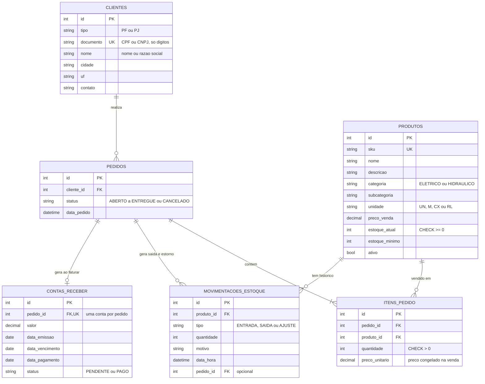

# EletroHidro Distribuidora — API

API REST de **estoque, vendas e financeiro** de uma distribuidora fictícia de materiais elétricos e hidráulicos,
feita em **Python 3.12 + FastAPI + PostgreSQL**. Projeto de portfólio que reúne CRUD com regras de negócio
transacionais, **relatórios em SQL puro** e uma **integração com IA (Claude)** que responde perguntas em português
consultando o banco com travas de segurança.

> Navegue pelo Swagger em `http://localhost:8000/docs` assim que subir o projeto (passo a passo [abaixo](#como-rodar)).

## Sumário

[Problema de negócio](#problema-de-negócio) ·
[Funcionalidades](#funcionalidades) ·
[Stack](#stack) ·
[Como rodar](#como-rodar) ·
[Diagrama do banco](#diagrama-do-banco) ·
[Exemplos de requisições](#exemplos-de-requisições) ·
[Endpoints](#endpoints) ·
[IA e segurança](#ia-e-segurança) ·
[Decisões técnicas](#decisões-técnicas) ·
[Histórias de usuário](#histórias-de-usuário) ·
[Estrutura](#estrutura-do-projeto) ·
[Limitações](#limitações-e-próximos-passos)

## Problema de negócio

A EletroHidro revende fios, cabos, disjuntores, tomadas, tubos PVC, conexões e registros para construtoras,
instaladores e consumidores finais. Hoje o controle é feito em planilhas, e isso causa problemas conhecidos:

- **estoque que não bate**: vende-se o que não existe, ou não se sabe o que repor;
- **pedido sem rastro**: não há registro confiável do que saiu do estoque e por quê;
- **inadimplência invisível**: ninguém sabe, no dia, quais clientes estão com contas vencidas;
- **gestão sem números**: o faturamento por mês, o ranking de clientes e os produtos mais vendidos exigem horas de planilha.

A API centraliza o ciclo **produto → estoque → pedido → faturamento → recebimento** com regras que impedem
os erros acima (estoque nunca negativo, baixa de estoque atômica, uma conta por pedido) e responde as perguntas
de gestão direto do banco.

## Funcionalidades

| Área | O que faz |
|---|---|
| **Produtos** | CRUD com filtros (categoria, subcategoria, ativo, busca por nome/SKU) e paginação. Exclusão lógica (inativar). |
| **Clientes** | PF (CPF) e PJ (CNPJ) com validação dos dígitos verificadores, filtros por UF/tipo. |
| **Movimentações de estoque** | `ENTRADA`, `SAIDA` e `AJUSTE` sempre com data, quantidade e motivo. O estoque **nunca** fica negativo. |
| **Pedidos** | `ABERTO → CONFIRMADO → FATURADO → ENTREGUE` ou `CANCELADO`. Confirmar valida e baixa o estoque na mesma transação; cancelar um pedido confirmado estorna. |
| **Financeiro** | Faturar gera a conta a receber (valor, vencimento). Pagamento via endpoint. `VENCIDO` é calculado na leitura. |
| **Relatórios (SQL puro)** | Mais vendidos, faturamento por categoria e mês, ranking de clientes (com filtro por UF), estoque abaixo do mínimo e contas vencidas por cliente. |
| **IA** | `POST /ia/perguntar`: pergunta em português → SQL (Claude) → validação → execução **somente leitura** → resultado. |

## Stack

- **Python 3.12**, **FastAPI**, **Pydantic v2**
- **SQLAlchemy 2.x** (ORM para o CRUD) e **SQL escrito à mão** via `text()` nos relatórios
- **PostgreSQL 16** (Docker Compose) e **Alembic** (migrações)
- **SDK oficial da Anthropic** (`anthropic`) e **sqlglot** (parser de SQL para validar o que a IA gera)
- **pytest + httpx** — testes contra um PostgreSQL real

## Como rodar

### Com Docker Compose (recomendado)

Pré-requisito: Docker. Subir o banco e a API leva um comando:

```bash
cp .env.example .env          # PowerShell: Copy-Item .env.example .env
docker compose up --build
```

Em outro terminal, carregue os dados de demonstração (43 produtos, 10 clientes, 30 pedidos em vários meses):

```bash
docker compose exec api python -m app.seed
```

Pronto: **Swagger em http://localhost:8000/docs**. O `docker compose up` já aplica as migrações (`alembic upgrade head`)
e, na primeira criação do volume, cria o usuário PostgreSQL somente leitura usado pela IA.

- Troque as senhas de exemplo no `.env` se for expor a porta do banco (`5433` no seu computador).
- Para **habilitar a IA**, preencha `ANTHROPIC_API_KEY` no `.env` e reinicie. Sem a chave, só o `POST /ia/perguntar`
  responde `503`; todo o resto funciona normalmente. O modelo vem de `ANTHROPIC_MODEL` (padrão `claude-opus-5-5`;
  `claude-sonnet-5-5` ou `claude-haiku-5-5` são mais baratos).
- Para recomeçar do zero: `docker compose exec api python -m app.seed --limpar`.
- Se você já tinha um volume de banco criado antes do usuário somente leitura existir, rode uma vez
  `docker compose exec db sh /docker-entrypoint-initdb.d/01-somente-leitura.sh` (o script é idempotente).

### Rodando a API fora do Docker

```bash
python -m venv .venv && source .venv/bin/activate     # Windows: .venv\Scripts\activate
pip install -r requirements-dev.txt
cp .env.example .env
docker compose up -d db                                # só o banco
alembic upgrade head
python -m app.seed
uvicorn app.main:app --reload
```

### Testes

```bash
docker compose up -d db
pytest
```

Qualidade estática (configurada em `pyproject.toml`): `ruff check .`, `ruff format --check .` e `mypy app`; todos passam sem avisos.

A suíte (mais de 150 testes) usa um banco **separado** (`<nome do banco>_test`, criado automaticamente), então os dados de
desenvolvimento nunca são tocados. **Nenhum teste chama a API real da Anthropic**: o cliente é sempre simulado, e
a fixture do cliente real dispara erro se algum teste tentar usá-lo.

## Diagrama do banco



O total do pedido não é uma coluna: é calculado dos itens, então nunca fica dessincronizado. A situação `VENCIDO`
também é derivada (conta `PENDENTE` com vencimento no passado) em vez de gravada.

## Exemplos de requisições

Os exemplos abaixo usam os dados do seed (o produto novo recebe o id 44). No Windows PowerShell, prefira o
Swagger ou `Invoke-RestMethod`, pois as aspas e os acentos do `curl` se comportam de outro jeito.

**1. Cadastrar um produto** (nasce com estoque 0) e **dar entrada** no estoque:

```bash
curl -X POST localhost:8000/produtos -H "Content-Type: application/json" -d '{
  "sku": "DJ-BIP-32A", "nome": "Disjuntor Bipolar 32A Curva C", "categoria": "ELETRICO",
  "subcategoria": "Disjuntores", "unidade": "UN", "preco_venda": "28.90", "estoque_minimo": 10 }'

curl -X POST localhost:8000/movimentacoes -H "Content-Type: application/json" -d '{
  "produto_id": 44, "tipo": "ENTRADA", "quantidade": 50, "motivo": "Compra do fornecedor - NF 1234" }'
```

**2. O estoque nunca fica negativo** (`409`, e nada é gravado):

```bash
curl -X POST localhost:8000/movimentacoes -H "Content-Type: application/json" -d '{
  "produto_id": 44, "tipo": "SAIDA", "quantidade": 80, "motivo": "Venda balcao" }'
# {"detail":"Estoque insuficiente para DJ-BIP-32A: saldo atual 50, movimentação de -80."}
```

**3. Validação com mensagem em português** (`422`):

```bash
curl -X POST localhost:8000/clientes -H "Content-Type: application/json" -d '{
  "tipo": "PF", "documento": "111.111.111-11", "nome": "Fulano", "cidade": "Santos", "uf": "SP" }'
# {"detail":"Dados inválidos.","erros":[{"campo":"documento","mensagem":"CPF inválido."}]}
```

**4. Ciclo do pedido**: criar → confirmar (baixa o estoque) → faturar (gera a conta) → pagar:

```bash
curl -X POST localhost:8000/pedidos -H "Content-Type: application/json" -d '{
  "cliente_id": 1, "itens": [ {"produto_id": 44, "quantidade": 10}, {"produto_id": 13, "quantidade": 20} ] }'
# {"id":31,"status":"ABERTO","itens":[{"produto_id":44,"quantidade":10,"preco_unitario":"28.90","subtotal":"289.00"}, ...],"total":"479.00", ...}

curl -X POST localhost:8000/pedidos/31/confirmar                       # status CONFIRMADO; estoque do produto 44: 50 → 40
curl -X POST "localhost:8000/pedidos/31/faturar?dias_vencimento=30"    # status FATURADO + conta a receber
curl "localhost:8000/contas-receber?pedido_id=31"                      # valor 479.00, vencimento daqui a 30 dias, PENDENTE
curl -X POST localhost:8000/contas-receber/23/pagamento                # PAGO (sem corpo = pago hoje)
```

**5. Confirmar é tudo ou nada**: um pedido com 1 unidade do produto 44 e 5 do produto 10 (estoque 0) falha, e a unidade do
produto 44 não é baixada:

```bash
curl -X POST localhost:8000/pedidos/32/confirmar
# {"detail":"Estoque insuficiente para DJ-TRI-63A: saldo atual 0, movimentação de -5."}   (HTTP 409)
```

**6. Listagens com filtros e paginação**:

```bash
curl "localhost:8000/produtos?categoria=ELETRICO&subcategoria=Disjuntores&tamanho=5&pagina=1"
curl "localhost:8000/pedidos?status=CONFIRMADO&data_inicio=2026-10-01"
```

**7. Relatórios** (os de vendas aceitam `data_inicio`/`data_fim`; veja o Swagger para os demais filtros):

```bash
curl "localhost:8000/relatorios/produtos-mais-vendidos?limite=3"
# [{"sku":"CAB-PP-3X2.5","quantidade_vendida":99,"faturamento":"970.20", ...}, {"sku":"LAMP-LED-9W","quantidade_vendida":58, ...}, ...]

curl "localhost:8000/relatorios/faturamento-por-categoria-mes?data_inicio=2026-09-01"
# {"mes":"2026-09","categoria":"ELETRICO","faturamento":"1388.00","qtd_pedidos":3}, {"mes":"2026-09","categoria":"HIDRAULICO", ...}, ...

curl "localhost:8000/relatorios/ranking-clientes?uf=SP&limite=3"
# {"posicao":1,"nome":"Elétrica Brasil Instalações Ltda","qtd_pedidos":6,"faturamento":"3854.70", ...}, {"posicao":2, ...}

curl "localhost:8000/relatorios/estoque-abaixo-do-minimo?subcategoria=disjuntores"
# DJ-MONO-20A (13 de 40), DJ-MONO-32A (13 de 40), DJ-TRI-63A (0 de 10)

curl localhost:8000/relatorios/contas-vencidas        # total vencido, quantidade e dias de atraso por cliente
```

**8. Pergunta em português (IA)**. Requer `ANTHROPIC_API_KEY`:

```bash
curl -X POST localhost:8000/ia/perguntar -H "Content-Type: application/json" \
  -d '{"pergunta": "Quais disjuntores estão abaixo do estoque mínimo?"}'
```

Formato da resposta. O SQL é o tipo de consulta que o modelo costuma gerar para essa pergunta; o resultado é o que o
pipeline devolve sobre os dados do seed, com validação e usuário somente leitura reais:

```json
{
  "pergunta": "Quais disjuntores estão abaixo do estoque mínimo?",
  "sql": "SELECT sku, nome, estoque_atual, estoque_minimo FROM produtos WHERE ativo AND subcategoria ILIKE 'Disjuntores' AND estoque_atual < estoque_minimo ORDER BY sku LIMIT 101",
  "colunas": ["sku", "nome", "estoque_atual", "estoque_minimo"],
  "linhas": [
    ["DJ-MONO-20A", "Disjuntor Monopolar 20A Curva C", 13, 40],
    ["DJ-MONO-32A", "Disjuntor Monopolar 32A Curva C", 13, 40],
    ["DJ-TRI-63A", "Disjuntor Tripolar 63A Curva C", 0, 10]
  ],
  "total_linhas": 3,
  "truncado": false
}
```

Sem a chave configurada: `503` com `"O recurso de IA está desativado: defina a variável de ambiente ANTHROPIC_API_KEY. O restante da API funciona normalmente."`

## Endpoints

| Recurso | Rotas |
|---|---|
| Produtos | `POST /produtos` · `GET /produtos` · `GET/PATCH/DELETE /produtos/{id}` (DELETE = inativar) |
| Clientes | `POST /clientes` · `GET /clientes` · `GET/PATCH/DELETE /clientes/{id}` |
| Movimentações | `POST /movimentacoes` · `GET /movimentacoes` |
| Pedidos | `POST /pedidos` · `GET /pedidos` · `GET /pedidos/{id}` · `POST /pedidos/{id}/confirmar` · `/faturar` · `/entregar` · `/cancelar` |
| Financeiro | `GET /contas-receber` · `GET /contas-receber/{id}` · `POST /contas-receber/{id}/pagamento` |
| Relatórios | `GET /relatorios/produtos-mais-vendidos` · `/faturamento-por-categoria-mes` · `/ranking-clientes` · `/estoque-abaixo-do-minimo` · `/contas-vencidas` |
| IA | `POST /ia/perguntar` |
| Infra | `GET /saude` |

Códigos de erro: `400` parâmetro inválido (ex.: `data_inicio` depois de `data_fim`) · `404` não encontrado ·
`409` conflito com o estado atual (estoque insuficiente, SKU/documento duplicado, transição de status inválida) ·
`422` dados inválidos · `502`/`503` apenas no endpoint de IA.

## IA e segurança

O modelo gera texto, e **texto gerado por modelo é entrada não confiável** (pode errar, ou ser manipulado por uma pergunta
maliciosa, o chamado *prompt injection*). Por isso a segurança não depende de o modelo "se comportar": há camadas
independentes, e as do banco continuam valendo mesmo que as da aplicação falhem.

| # | Camada | Onde | O que garante |
|---|---|---|---|
| 1 | **Esquema mínimo** | prompt | O modelo só vê as 6 tabelas do domínio (geradas dos modelos ORM). `alembic_version` e tabelas do sistema nunca são reveladas. |
| 2 | **Parser SQL** (`sqlglot`) | aplicação | Exatamente **um** `SELECT`. Recusa `INSERT/UPDATE/DELETE/DDL/COPY/SET`, inclusive escondidos em CTE, e `SELECT INTO`/`FOR UPDATE`. Falha fechada: o que o parser não entende é recusado. Executa o SQL **regenerado** da árvore validada, não o texto original. |
| 3 | **Allowlist** | aplicação | Só as tabelas do domínio (schemas `pg_catalog`/`information_schema` e funções `pg_*`, `lo_*`, `dblink`, `set_config` bloqueados). |
| 4 | **LIMIT máximo** | aplicação | `LIMIT` imposto (`IA_MAX_LINHAS`, padrão 100); a resposta indica `truncado`. |
| 5 | **Usuário somente leitura** | banco | `eletrohidro_ro` só tem `GRANT SELECT`. Mesmo um `DELETE` que passasse pelo parser levaria `permission denied`. |
| 6 | **Transação `READ ONLY` + timeout** | banco | O papel força `default_transaction_read_only` e `statement_timeout`; a execução abre a transação como `READ ONLY` e cancela a consulta após `IA_TIMEOUT_SEGUNDOS` (padrão 5). |
| 7 | **Trilha de auditoria** | aplicação | Toda consulta executada é registrada no log (`app.services.ia`) com a pergunta e o SQL; as **rejeitadas** também, em nível `WARNING`, com o SQL recusado e o motivo. |

Cada camada tem teste próprio: o de camada 5 contorna o parser de propósito, e o `SELECT pg_sleep()` contorna o validador para provar o timeout.

## Decisões técnicas

- **Camadas** (`routers` → `services` → `repositories`, mais `schemas` Pydantic). O service decide a transação; o router só traduz HTTP.
  Relatórios não têm service: são consultas puras de leitura.
- **ORM para escrita, SQL para análise.** O CRUD usa SQLAlchemy; os 5 relatórios são SQL à mão, com parâmetros *bind*
  (sem concatenar texto), `JOIN`, `GROUP BY`, `COUNT(DISTINCT)`, filtros opcionais e `RANK() OVER`.
- **Regras no banco, não só no código.** `CHECK (estoque_atual >= 0)`, `UNIQUE (pedido_id)` em contas, `CHECK` de CPF/CNPJ por tipo.
  Um bug na aplicação não consegue corromper os dados.
- **Transações explícitas e locks.** Cada transição de pedido é uma transação (`with transacao(db)`); linhas são travadas com
  `SELECT ... FOR UPDATE`. Os produtos são travados **em ordem de id** para dois pedidos nunca causarem *deadlock*. Há teste
  que reproduz o *lost update* (vender 12 de um estoque de 10) e falha sem o lock.
- **O estoque só muda por movimentação.** `estoque_atual` não é editável pela API; todo saldo tem trilha de auditoria
  (o teste do seed confere que saldo = soma das movimentações para todos os produtos).
- **Preço congelado no item**, **total calculado** e **`VENCIDO` derivado**: dados derivados não ficam gravados para não envelhecer.
- **Dinheiro é `Decimal`** (`NUMERIC(12,2)`), serializado como string no JSON; nunca `float`.
- **Erros centralizados** em um único *handler*: services lançam exceções de domínio sem saber de HTTP; o `422` do Pydantic é
  traduzido para português, com campo e mensagem.
- **Testes contra PostgreSQL real**, em banco separado, porque as regras dependem de recursos do Postgres (`CHECK`, `FOR UPDATE`,
  SQL dos relatórios). SQLite escondería bugs reais. Os valores esperados dos relatórios foram calculados à mão.
- **Migrações com Alembic**, geradas por *autogenerate* e revisadas; convenção de nomes para as constraints.
- **Seed pelos próprios services**, não por `INSERT`: os dados nascem consistentes e o seed funciona como teste de ponta a ponta.
  É determinístico (semente fixa) e recua as datas para os relatórios por mês fazerem sentido.

## Histórias de usuário

### 1. Controlar o estoque
**Como** almoxarife, **quero** registrar entradas, saídas e ajustes, **para** que o saldo reflita o que está na prateleira.

- **Dado** um produto com saldo 50, **quando** registro uma SAÍDA de 20, **então** o saldo passa a 30 e fica registrada uma movimentação com data, quantidade e motivo.
- **Dado** um produto com saldo 5, **quando** registro uma SAÍDA de 6, **então** a API responde `409` ("Estoque insuficiente"), o saldo continua 5 e nenhuma movimentação é gravada.
- **Dado** um produto com saldo 10, **quando** registro um AJUSTE de −3 (perda no inventário), **então** o saldo passa a 7; **e** um AJUSTE que o deixaria negativo é recusado com `409`.
- **Dado** uma movimentação sem motivo, ou ENTRADA com quantidade negativa, **quando** envio, **então** recebo `422` indicando o campo e a mensagem em português.

### 2. Montar, confirmar e cancelar pedidos
**Como** vendedor, **quero** criar pedidos e confirmá-los, **para** reservar o estoque sem vender o que não existe.

- **Dado** um cliente e produtos ativos, **quando** crio um pedido, **então** ele nasce `ABERTO`, com o preço atual de cada produto congelado nos itens, e o estoque permanece intacto.
- **Dado** um pedido `ABERTO` com estoque suficiente, **quando** o confirmo, **então** o status vira `CONFIRMADO` e uma SAÍDA por item é registrada na mesma transação.
- **Dado** um pedido de dois itens em que um não tem estoque, **quando** o confirmo, **então** recebo `409`, **nenhum** item é baixado e o pedido continua `ABERTO`.
- **Dado** um pedido `CONFIRMADO`, **quando** o cancelo, **então** ele vira `CANCELADO` e o estoque é estornado por ENTRADAs; **e** um pedido já faturado não pode ser cancelado (`409`).

### 3. Faturar e acompanhar recebimentos
**Como** analista financeiro, **quero** faturar pedidos e registrar pagamentos, **para** saber quanto há a receber e de quem.

- **Dado** um pedido `CONFIRMADO`, **quando** o fatura com `dias_vencimento=30`, **então** ele vira `FATURADO` e é criada uma conta `PENDENTE` com o valor do pedido e vencimento em 30 dias.
- **Dado** um pedido ainda não confirmado, **quando** tento faturá-lo, **então** recebo `409` e nenhuma conta é criada; **e** faturar duas vezes nunca gera duas contas.
- **Dado** uma conta `PENDENTE`, **quando** registro o pagamento, **então** ela vira `PAGO` com a data; um segundo pagamento retorna `409` e uma data futura retorna `400`.
- **Dado** uma conta `PENDENTE` com vencimento no passado, **quando** a consulto, **então** ela aparece como `VENCIDO` e entra em `GET /contas-receber?status=VENCIDO`.

### 4. Analisar vendas e reposição
**Como** gerente, **quero** relatórios de faturamento, clientes e estoque, **para** decidir compras e cobranças.

- **Dado** pedidos faturados em meses diferentes, **quando** consulto `/relatorios/faturamento-por-categoria-mes`, **então** recebo uma linha por mês e categoria; pedidos abertos, confirmados e cancelados **não** entram.
- **Dado** clientes de várias UFs, **quando** consulto `/relatorios/ranking-clientes?uf=SP`, **então** vejo só clientes de SP, do maior para o menor faturamento, com a posição de cada um.
- **Dado** produtos com saldo menor que o mínimo, **quando** consulto `/relatorios/estoque-abaixo-do-minimo?subcategoria=disjuntores`, **então** recebo os produtos ativos nessa condição, com a quantidade que falta repor, do mais crítico ao menos.
- **Dado** contas pendentes vencidas, **quando** consulto `/relatorios/contas-vencidas`, **então** vejo, por cliente, o total vencido, a quantidade de contas e os dias de atraso.

### 5. Perguntar em português
**Como** gestor, **quero** fazer perguntas em linguagem natural sobre o negócio, **para** obter respostas sem escrever SQL.

- **Dado** que a `ANTHROPIC_API_KEY` está configurada, **quando** pergunto "Quais disjuntores estão abaixo do estoque mínimo?", **então** recebo o SQL executado e o resultado (no máximo 100 linhas; `truncado` indica se houve corte).
- **Dado** que o modelo gere algo que não seja um único `SELECT` sobre as tabelas permitidas (ex.: um `DELETE`), **quando** a resposta chega, **então** a API responde `422` e **nada** é executado.
- **Dado** uma consulta que demora mais que o limite, **quando** ela é executada, **então** é cancelada e recebo `422` informando o tempo limite.
- **Dado** que a chave não está configurada, **quando** chamo `/ia/perguntar`, **então** recebo `503` com mensagem clara, e todos os demais endpoints continuam funcionando.

## Estrutura do projeto

```
app/
  main.py            # FastAPI, Swagger, registro dos routers
  config.py          # variáveis de ambiente (pydantic-settings)
  database.py        # engine, sessão e o helper transacao()
  models.py          # modelos SQLAlchemy (6 tabelas)
  errors.py          # exceções de domínio e handlers HTTP
  routers/           # HTTP: validação de entrada e resposta
  schemas/           # DTOs Pydantic (request/response)
  services/          # regras de negócio e transações (inclui ia.py e sql_seguro.py)
  repositories/      # consultas (ORM) e SQL puro (relatorios.py, leitura.py)
  seed.py            # dados de demonstração
alembic/             # migrações
docker/initdb/       # cria o usuário PostgreSQL somente leitura
tests/               # pytest (banco real, Anthropic simulada)
```

## Limitações e próximos passos

Escolhas deliberadas de escopo, que viram a lista do que faria a seguir:

- **Sem autenticação/autorização.** Como a API é aberta, o `/ia/perguntar` pode ler qualquer coluna das tabelas do domínio, inclusive CPF/CNPJ.
  Em produção: autenticação, e `GRANT` por coluna (ou *views*) para o usuário somente leitura.
- **Pagamento integral** (sem parcelas) e **pedidos não editáveis** depois de criados (cancela-se e cria-se outro).
- **Pedido faturado ou entregue não pode ser cancelado**: exigiria cancelar a conta a receber e tratar a devolução.
- **Relatórios sem paginação** (têm `limite`); para volumes grandes, paginar ou materializar.
- **IA:** a qualidade do SQL depende do modelo escolhido; a suíte valida as travas e o contrato com o SDK, não a qualidade das respostas
  de um modelo real. Uma recusa do modelo (`refusal`) vira `422` com mensagem clara, sem *fallback* automático para outro modelo.
